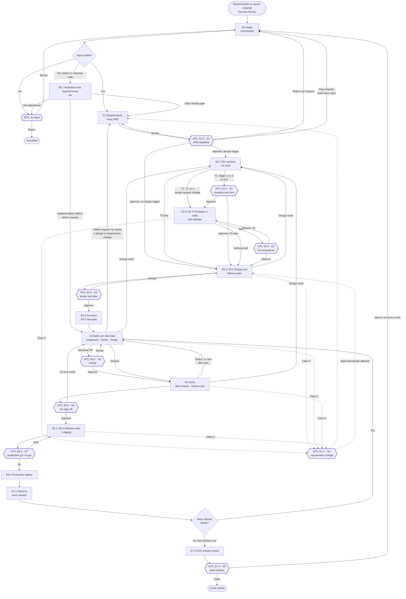
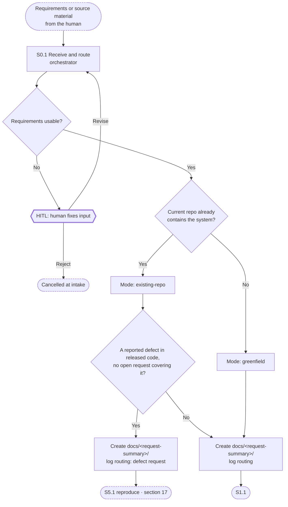
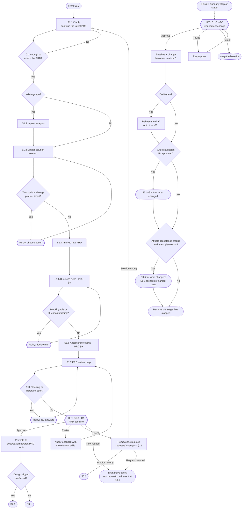
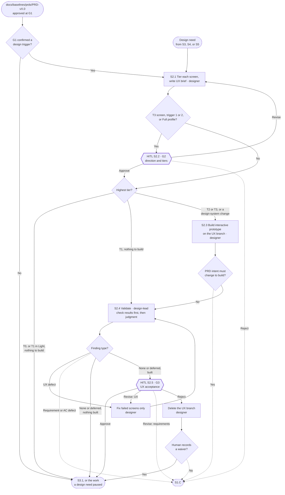
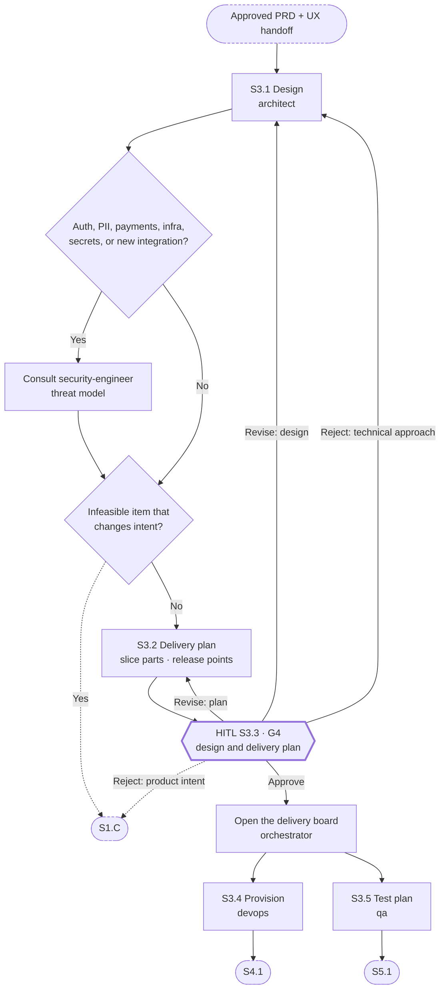
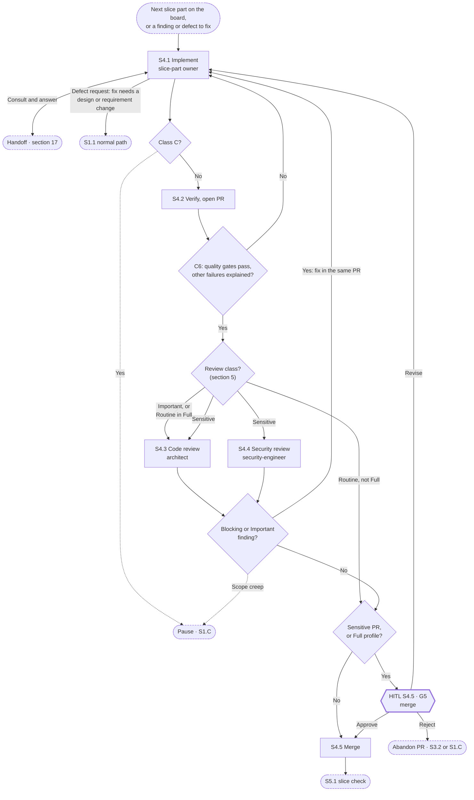
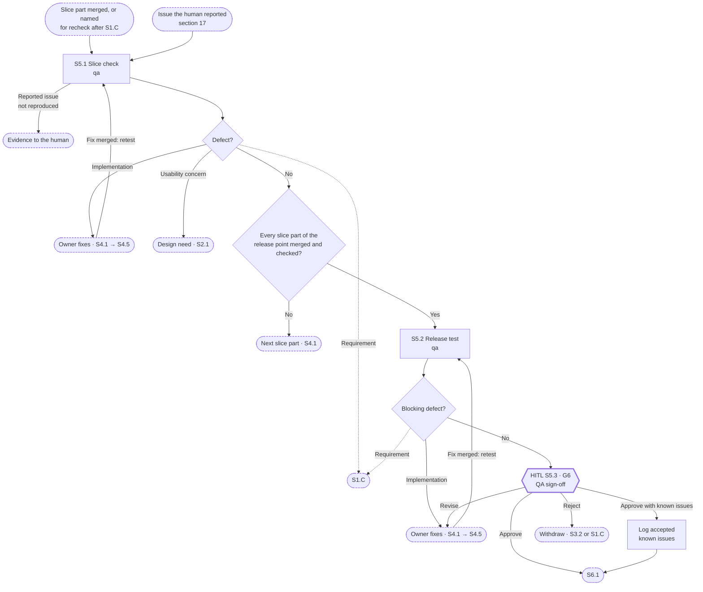
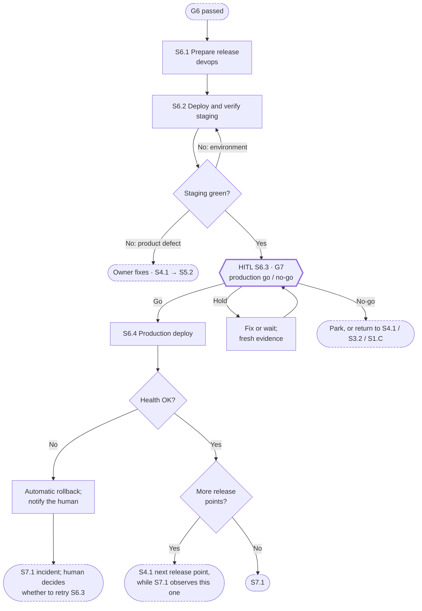
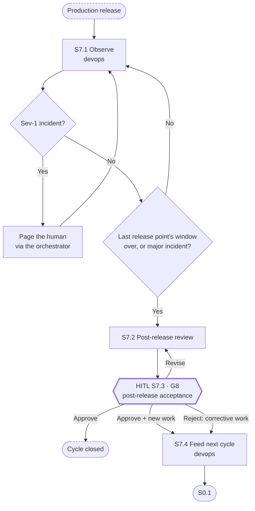

# Agent SDLC Playbook

Single source of truth for the SDLC process of an AI-operated software company. The orchestrator reads this file for sequence, gates, routes, file locations, and tools, and hands each agent only its own step. Agents read `.cursor/sdlc/AGENT-RULES.md`, not this whole file.

**Human gives:** requirements. Agents work in the current repository.  
**Agents do:** every step below.  
**Human decides only** when a step says `HITL`. Each HITL step defines **Approve**, **Revise**, and **Reject**.

Each fact lives in one place. This playbook owns who, when, where, gates, and routes. `.cursor/sdlc/AGENT-RULES.md` owns what every agent needs on every step: invocation, non-negotiables, findings and change control, handoffs, and the operating protocol. `.cursor/agents/` own role identity, `.cursor/skills/` own how a step is done and what content it produces, and `.cursor/sdlc/templates/` own document shapes. All paths in this playbook are relative to the project root.

---

## 1. How to read a step

| Field | Meaning |
|---|---|
| **Agent** | Who runs the step (stage-wide when stated once) |
| **Skill** | The method, in `.cursor/skills/<skill>/SKILL.md` |
| **Input / Output** | What the step reads and writes; path rules are in `AGENT-RULES.md` (Invocation) |
| **Stop?** | The condition that stops the step: HITL, Class C, a handoff to another role, or a reroute |
| **Next / On Approve / Revise / Reject** | Exact next step IDs; the route words are defined in `AGENT-RULES.md` (Invocation) |

These rows, copied verbatim, are the **step card** the orchestrator hands an agent.


**Diagram legend** (process overview in section 2, one diagram at the top of each stage):

| Shape | Meaning |
|---|---|
| Rectangle | Step an agent runs |
| Diamond | Condition |
| Hexagon, heavy border | HITL — the human decides |
| Rounded, dashed | Entry, exit, or jump to a step in another stage |
| Dotted arrow | Class C escalation to S1.C |

---

## 2. Process overview



**Order:** define product intent → design the experience when the change needs it → design and plan delivery → build, review, and merge each slice part → verify each release point → ship it → repeat for the next release point → learn.

After G4 the work is a loop, not a line: slice parts are built and merged one by one, QA checks each as it merges, and every release point is tested, signed off, and shipped before the next. Agents hand work to each other through the orchestrator (section 17).

Agents work in the current repository and read its files directly when a step needs them.

| Current repository | Mode |
|---|---|
| Already contains the system being changed | `existing-repo`; S1.2 impact analysis runs |
| Contains no system yet | `greenfield`; S1.2 is skipped |

**Checks and gates** (section 18). A **check** (C1–C7) is an agent's exit criterion: the agent does not move on until it holds, and no human stops. A **gate** (G1–G8, GC) is the human's decision. Gates in order: G1 → (G2, G3 when section 11 says they stop) → G4 → (G5 for Sensitive merges, and every merge in Full) → G6 → G7 per release point → G8. GC can happen at any time. A defect request (section 17) has no G1–G4.

---

## 3. Agent roster

The **orchestrator** is the main Claude session, not a subagent. It runs S0.1, invokes each agent for its steps, relays every HITL package to the human and the decision back, and keeps `DECISION-LOG.md` current. From G4 on (from S5.1 for a defect request) it also keeps the delivery board, routes handoffs between agents, and merges reviewed PRs (section 17). It hands every issue the human reports to `qa` (section 17, Reported issues). Agents follow `AGENT-RULES.md`.

**Deterministic checks.** `.cursor/sdlc/scripts/sdlc-check.py` (Python 3.10+, no dependencies) checks the process documents: baselines never edited and fully approved, the PRD in template shape, every gate recorded in `DECISION-LOG.md` with dates in order and none in the future, the package committed on the default branch, sensitive merges through G5, no sign-off over an open Blocking defect, and a delivery board that is consistent and current: every planned part has a row, and every PR with a security review shows on it with its status, a released release point has no slice-part rows left and its G7 Go row moved to `decisions/`, and no closed handoff remains. The orchestrator runs it from the project root:

- before presenting a gate package: `python .cursor/sdlc/scripts/sdlc-check.py --request <request-summary> --gate <G1–G8>`, adding `--release <release point>` for G6 and G7 and `--pr <number>` for G5. A failure goes back to the agent that owns the fix; the package is not shown to the human until the check passes;
- after recording each decision, without `--gate`. A failure is fixed before the next delegation.

CI also runs it on every PR (S3.4).

After each merge (S4.5, and the merge into the default branch at S6.4), the orchestrator runs `python .cursor/sdlc/scripts/clean-worktrees.py --into origin/release/<request-summary>`, adding `--into origin/<default branch>` at S6.4. It removes only agent worktrees with no uncommitted changes whose work is merged, with their local branches.

**Guard hook** (Claude Code). `.cursor/sdlc/hooks/guard.py`, registered by the installer in the project's `.claude/settings.json`, runs before every file edit and shell command of the orchestrator and every agent. It refuses changing or deleting an existing baseline file, an agent writing `delivery/BOARD.md`, `DECISION-LOG.md`, or `decisions/`, force-pushing, pushing to `main` or `master`, switching a checkout to a ref without the package, `--no-verify`, and writing content that looks like a real secret. The human's own edits are not checked.

**UI catalog.** `.cursor/sdlc/scripts/ui-catalog.py` generates `docs/COMPONENTS.md` from the doc blocks in component source and the design-tokens file. Agents choose components and tokens from it instead of reading component source. Whoever adds or changes a component or token reruns it (`designer` in S2.3, `frontend-developer` in S4.1), and CI runs it with `--check` on every PR as a quality gate in the engineering standards.

**Delegating a step.** The orchestrator reads the stage it is in and hands the owning agent a step card as `AGENT-RULES.md` (Invocation) defines: one step, or a run of consecutive steps that agent owns with no HITL between them. Every delegation starts a new agent session, including answers to a blocked step, a Revise on the same gate, and the answer to a handoff. The work so far is in the step's output files, so a resumed agent reads those files instead of carrying the earlier conversation. The orchestrator may continue the same session only when the reply comes back within a few minutes, while that agent's context is still cached.

**Keeping delegations cheap.** Every turn of a session re-reads its whole context, so the orchestrator:

- **Batches.** Several PRs waiting for the same reviewer go to that reviewer in one delegation; so do several slice checks or retests for `qa`.
- **Matches the model to the step.** Each agent runs on the model in the roster below, set in its agent file: `opus` where an error propagates downstream or the agent is the last check before a human gate, `sonnet` for high-volume work from a detailed plan that a stronger agent and CI check afterwards. The orchestrator itself runs on `opus`, chosen by the human for the main session. It overrides an agent's model for one delegation only to `sonnet` for a code-review re-check, or to `opus` for a developer's slice part that failed review or retest twice.
- **Keeps its own context small.** It acts on final messages and the board, and opens an agent's files only when a gate package or a routing decision needs them. It records state in `delivery/BOARD.md` and `DECISION-LOG.md` as each message arrives, so it can continue in a fresh session from those two files after each release point, or sooner when its context grows long.

| Agent | ID | Owns | Prepares human gate | Model |
|---|---|---|---|---|
| Requirements Analyst | `requirements-analyst` | S1.*; answers acceptance-criteria consults during delivery | **S1.8 (G1)**, **S1.C (GC)** | `opus` |
| Designer | `designer` | S2.1–S2.3; deletes a rejected request's UX branch after G3 | **S2.2 (G2)** direction and tiers, when it stops | `opus` |
| Design Lead | `design-lead` | S2.4–S2.5 | **S2.5 (G3)** UX acceptance, when it stops | `opus` |
| Architect | `architect` | S3.1–S3.2, S4.3; answers design consults and root-causes repeated defects | **S3.3 (G4)**; **S4.5 (G5)** with security | `opus` |
| Front-end Developer | `frontend-developer` | S4.1–S4.2 for front-end slice parts, including their fixes | — | `sonnet` |
| Back-end Developer | `backend-developer` | S4.1–S4.2 for back-end slice parts, including their fixes | — | `sonnet` |
| Security Engineer | `security-engineer` | S4.4; consulted at S3.1 and during S4.1 | **S4.5 (G5)** with architect | `opus` |
| QA | `qa` | S3.5, S5.1–S5.2 | **S5.3 (G6)** | `sonnet` |
| DevOps | `devops` | S3.4, S6.1–S6.4, S7.1–S7.4; environment handoffs | **S6.3 (G7)**, **S7.3 (G8)** | `sonnet` |

### Separation of duties

- `design-lead` never validates UX work it built or edited.
- `architect` and `security-engineer` never review a PR they authored. `security-engineer` does not fix code.
- `qa` does not fix product code and cannot waive a blocking defect.
- Developers implement and fix only slice parts assigned to them in `IMPLEMENTATION-PLAN.md`; a defect in another part goes to its owner, and a contract change needs `architect` first.
- No agent answers a question owned by another role; it hands it off (section 17).
- `requirements-analyst`, `designer`, and `design-lead` need no production credentials. No agent commits secrets.

### Skill ownership

| Owner | Skills |
|---|---|
| orchestrator | `intake-and-routing` |
| `requirements-analyst` | `requirements-clarification`, `existing-system-impact-analysis`, `similar-solution-research`, `requirements-analysis`, `business-rules-and-scenario-analysis`, `acceptance-criteria-and-test-design`, `prd-review-and-baseline` |
| `designer` | `ux-planning`, `design-system-design`, `ui-design` |
| `design-lead` | `ux-validation`, `ui-design-review` |
| `architect` | `architecture-and-technical-design`, `engineering-standards`, `implementation-planning`, `code-review` |
| `frontend-developer` | `feature-implementation`, `ui-implementation` |
| `backend-developer` | `feature-implementation`, `backend-implementation` |
| `security-engineer` | `threat-modeling`, `security-review` |
| `qa` | `qa-test-planning`, `qa-test-execution` |
| `devops` | `environment-provisioning`, `release-preparation`, `deployment`, `operations-observation`, `post-release-review`, `new-feature-request` |

---

## 4. Non-negotiables

In `AGENT-RULES.md` (Non-negotiables). They bind the orchestrator too.

---

## 5. Profiles

The human chooses the profile at intake; if they name none, use **Standard**.

| Profile | Tailoring |
|---|---|
| **Light** | Short research (a few comparables still required). Rules and acceptance criteria may be folded into analysis. T1 screen specs go to S3.1 without S2.4. Security review of a Sensitive PR may be a spot check of the part's security requirements. May present G6 and G7 in one stop after the release test and green staging; still record both gate outcomes. **G7 stays HITL.** |
| **Standard** | Full phases. G2 and G3 stop only when section 11 says. Reviews follow the review class. G5 stops only for Sensitive PRs. |
| **Full** | Independent validation at each gate. G2 always stops for the human to confirm the tiers. Code review on every PR, Routine included; security review on Sensitive PRs; **every** merge stops at G5. Dual control on production: G7 needs two named approvers, both recorded in `DECISION-LOG.md`. |

**Review class.** Every PR runs the quality gates in the engineering standards, security gates included (C6), and `qa` checks every merged slice part (S5.1). Agent reviews depend on the part's review class:

| Class | The PR | Reviews | G5 |
|---|---|---|---|
| **Routine** | Does nothing Important or Sensitive names: for example styling, copy, a new field or state in an existing pattern, tests, or documentation only | None; the orchestrator merges once CI is green on its head | Full only |
| **Important** | Changes a contract (API, event, or schema), the data model, or a migration; adds a module, layer, or shared piece; adds or upgrades a dependency (CI's dependency audit vets it); changes behavior existing callers rely on; adds a known exception to a quality gate; or is sized L | S4.3 code review | Full only |
| **Sensitive** | Touches authentication, authorization, personal data, payments, secrets, or infrastructure; or adds a known exception to a security gate | S4.3 code review and S4.4 security review | Every profile |

A part takes the highest class that applies. `architect` sets it per slice part in the delivery plan (S3.2), approved at G4. The slice-part owner raises it in the PR when the diff does more than the part plan expected, and a reviewer raises it when the diff warrants; after G4 nothing lowers it. The orchestrator routes each PR by its highest class and keeps the board's class current.

---

## 6. Findings and change control

In `AGENT-RULES.md` (Findings and change control): severity, change classes A–C, finding types, owners, and routes. Class C always returns to S1.C (section 10).

---

## 7. PRD baselines

**Baselines** are the product's approved reference, and only the PRD has them: approved PRD versions in `docs/baselines/prds/`.

### PRD

The product has one PRD and one living file for it, `docs/PRD.md`, which always holds the latest version. Versions are `x.y`:

- **`vX.0` is approved.** Each is copied unchanged to `docs/baselines/prds/PRD-vX.0.md`; the highest is the current baseline.
- **`vX.y` with `y > 0` is the open draft.** There is at most one, and it is `docs/PRD.md` with document control **Draft** or **Pending approval**.

**Each request continues `docs/PRD.md`** as the next draft: `v1.0` → `v1.1`, `v1.1` → `v1.2`. The first request ever starts at `v0.1` from `.cursor/sdlc/templates/PRD.md`. If baselines exist but `docs/PRD.md` does not, the next request creates it from the current baseline as `vX.1`. Requests run through S1 one at a time, and PRD §12 records which request made each change. The next draft also folds in what each request's `analysis/finding-notes.md` recorded since the baseline: Class A clarifications, each with its own §12 row, and Class B gaps and risks still open, into §10 or §11.

**Baselines keep the template they were approved in.** When `.cursor/sdlc/templates/PRD.md` has changed since the baseline, the next draft moves the baseline's content into the current template's sections without changing any requirement, rule, or criterion, and records the reshape in §12 as its own row.

**Approval happens once, at G1, not per request.** Several requests can add to the draft first. On approval the draft becomes the next `vX.0` (`v1.2` → `v2.0`): document control **Approved**, and every §6 and §7 row still **Proposed** set to **Approved**. It is then copied unchanged to `docs/baselines/prds/`, and S2 or S3 continues in the folder of the request that took it to G1.

**Rejection is per request.** At G1 the human names which requests' changes are rejected; only those are removed, found through §12, and the rest of the draft stays open. If nothing remains, `docs/PRD.md` returns to the current baseline, or is marked **Canceled** when there is none.

**A Class C change starts from the baseline, not the draft.** S1.C proposes the change against the current baseline in its change request. On approval the baseline with the change becomes the next `vX.0` at once, so the paused stage resumes without waiting for unrelated draft content. If a draft was open, `requirements-analyst` reapplies the draft's changes, from its §12, onto the new baseline as `vX.1`, and raises any conflict as a Blocking §11 item.

---

## 8. Workspace layout

The PRD and its baselines live in `docs/PRD.md` and `docs/baselines/` (section 7). Everything else lives in one folder per request: `docs/<request-summary>/`. Use the same `<request-summary>` for every artifact of that request. "Analysis folder", "design folder", and so on mean the subfolders below.

```text
docs/PRD.md                        # the one living PRD, latest version; shape: PRD.md template (section 7)
docs/baselines/
  prds/
    PRD-v1.0.md, PRD-v2.0.md, …    # approved only; the highest is the current baseline
docs/COMPONENTS.md                 # generated UI catalog: components and design tokens; never edited by hand (section 3)
docs/ENGINEERING-STANDARDS.md      # living; the codebase's conventions and the tools that enforce them
docs/SYSTEM-ARCHITECTURE.md        # living; C4 model of the whole system, kept by architect
docs/<request-summary>/
  DECISION-LOG.md                  # every human decision for this request since the last released release point
  decisions/
    <release point>.md             # the earlier rows, moved when that release point is released (section 17)
  sources/                         # meeting notes, transcripts, documents as received; read-only
  change-requests/
    <yyyy-mm-dd>-<summary>.md      # Class C proposals for S1.C after the PRD is approved; shape: CHANGE-REQUEST.md template
  analysis/
    clarification-notes.md         # optional
    impact-analysis.md             # existing-repo only; shape: IMPACT-ANALYSIS.md template
    # similar-solution research: optional working paper under analysis/
    requirements-analysis.md       # optional; shape: REQUIREMENTS-ANALYSIS.md template
    business-rules-and-scenarios.md   # optional; canonical content is PRD §8
    acceptance-criteria.md         # optional; canonical content is PRD §9
    finding-notes.md               # Class A clarifications and Class B gaps and risks after G1; folded into the next PRD draft; shape: FINDING-NOTES.md template
  ux/
    UX-BRIEF.md                    # tiers, questions, screen specs, build record
    UX-REVIEW.md                   # check results, design review, handoff note for architecture
    directions/                    # screenshots of each T3 direction, shown at G2
    screens/                       # screenshots of each T2 and T3 state and each restyled screen, mobile and desktop; approved at G3
  design/
    ARCHITECTURE.md
    THREAT-MODEL.md                # when security-engineer is consulted
    IMPLEMENTATION-PLAN.md         # index: slice parts, release points, CI; locked at G4
    parts/
      <part ID>.md                 # one part plan per slice part, at most 60 lines; locked at G4
  delivery/
    BOARD.md                       # the delivery loop's state; written only by the orchestrator (section 17)
  testing/
    TEST-PLAN.md
    reports/
      <release point>.md           # one test report per release point
    security/
      PR-<number>.md               # one security review per Sensitive PR, updated in place on re-checks
    defects/
      <defect ID>.md               # one per defect or incident, only when no issue store is connected
  release/
    RELEASE-PLAN.md                # one section per release point
    POST-RELEASE-REVIEW.md
```

**Branches.** Claude Code starts every agent worktree from the default branch (on the remote, when there is one), so the package (`.claude/`) is committed there, and pushed, before any request: the installer commits it, creating the repository first for greenfield. When a remote is added to a new repository, `main` is pushed to it first, so it becomes the remote's default branch. At S0.1 the orchestrator checks this, then cuts the **request branch** `release/<request-summary>` from it; its own checkout stays on that branch. Every process document (`docs/PRD.md`, `docs/baselines/`, and `docs/<request-summary>/`) is committed straight to the request branch, with no PR, and pushed when there is a remote before the next delegation, because part branches and reviewers work from the remote. The UX branch and every part branch are cut from the request branch, and every PR targets it. The request branch merges into the default branch only after a G7 Go, once per release point. Each agent works on its own branch, in its own worktree when the runtime offers one, and never switches the branch of another checkout; no checkout ever switches to a ref without the package.

Application code lives in the current repository, outside `docs/`. UI code built in S2.3 stays on the branch `ux/<request-summary>` until front-end slice parts take it over in S4 and replace its prototype shell. For greenfield, the scaffold is created in S4 as the implementation plan describes. A file with a same-named template in `.cursor/sdlc/templates/` uses that shape, and so do the files in `change-requests/` (`CHANGE-REQUEST.md`), `design/parts/` (`PART-PLAN.md`), `testing/reports/` (`TEST-REPORT.md`), `testing/security/` (`SECURITY-REVIEW.md`), and `testing/defects/` (`DEFECT.md`); other files follow the Output section of their skill. Fill every section, or record the gap explicitly.

---

## 9. Stage S0 — Intake



### S0.1 Receive and route

| | |
|---|---|
| **Agent** | orchestrator |
| **Skill** | `intake-and-routing` |
| **Input** | The human's request: typed requirements, source material (meeting notes, transcripts, documents), or both. An issue the human reports in the scope of an open request does not come here: it goes to `qa` (section 17, Reported issues) |
| **Output** | The request branch (section 8); source material saved unchanged in `sources/`; `DECISION-LOG.md` routing row (mode, profile, route, next step) |
| **Stop?** | HITL only if the requirements are empty or unreadable, or the package is not committed (and pushed, when there is a remote) on the default branch |
| **On Revise** | The human fixes the input → S0.1 |
| **On Reject** | End the initiative; log "cancelled at intake" |
| **Next** | S1.1; for a defect request (section 17), S5.1 to reproduce the reported issue |

---

## 10. Stage S1 — Requirements

**Agent for every S1 step:** `requirements-analyst`. The canonical artifact is the one living `docs/PRD.md` (section 7); every S1 skill updates only the PRD sections its skill file names. Clarification alone is not the G1 package. No prototyping in this stage.

S1.1–S1.7 have no HITL between them, so the orchestrator can hand them over as one run. **Blocked vs defer** (`AGENT-RULES.md`) applies to every S1 step: a Blocking gap ends the run, after reading ahead through the later steps for their questions, and the blocked step resumes with all the answers; Important and Non-blocking gaps go in PRD §11 and the step continues.



### S1.1 Clarify

| | |
|---|---|
| **Skill** | `requirements-clarification` |
| **Input** | The request and its `sources/`; `docs/PRD.md` (section 7) |
| **Output** | `docs/PRD.md` updated in §§2–7 and §10 (§11 only when not blocked). Optional `analysis/clarification-notes.md` |
| **Stop?** | **Blocking** gaps stop the step (orchestrator relays). Class C → S1.C |
| **Next** | S1.2 in `existing-repo` mode, otherwise S1.3, once **C1** holds |

### S1.2 Impact analysis *(existing-repo only)*

| | |
|---|---|
| **Skill** | `existing-system-impact-analysis` |
| **Input** | `docs/SYSTEM-ARCHITECTURE.md` when it exists, then the parts of the repository it points to; the PRD draft and the current baseline |
| **Output** | `analysis/impact-analysis.md` (template shape). PRD §§6–7, §10, §11 (non-blocked items only) |
| **Stop?** | **Blocking** gaps stop the step. Class C → S1.C |
| **Next** | S1.3 once **C2** holds |

### S1.3 Similar-solution research

| | |
|---|---|
| **Skill** | `similar-solution-research` |
| **Output** | Optional working paper under `analysis/`. PRD §2, §4, §10, §11 (non-blocked items only) |
| **Stop?** | **Blocking** when two valid product directions remain: the human chooses, and the choice is recorded in the PRD. Class C → S1.C |
| **Next** | S1.4 |

### S1.4 Analyze

| | |
|---|---|
| **Skill** | `requirements-analysis` |
| **Output** | PRD §§6–7, §10, §11 (Important/Non-blocking during this step). Optional `analysis/requirements-analysis.md` |
| **Stop?** | **Blocking** gaps stop the step. Class C → S1.C |
| **Next** | S1.5 once **C3** holds |

### S1.5 Business rules and scenarios

| | |
|---|---|
| **Skill** | `business-rules-and-scenario-analysis` |
| **Output** | PRD §8. Optional `analysis/business-rules-and-scenarios.md` |
| **Stop?** | **Blocking** rule or threshold gaps stop the step; the human's answer is recorded in §8. Class C → S1.C |
| **Next** | S1.6 once **C4** holds |

### S1.6 Acceptance criteria

| | |
|---|---|
| **Skill** | `acceptance-criteria-and-test-design` |
| **Output** | PRD §9, with regression criteria in `existing-repo` mode. Optional `analysis/acceptance-criteria.md` |
| **Stop?** | **Blocking** verifiability gaps stop the step |
| **Next** | S1.7 once **C5** holds |

### S1.7 Prepare PRD for review

| | |
|---|---|
| **Skill** | `prd-review-and-baseline` (draft review) |
| **Output** | `docs/PRD.md`: template-only headings, refreshed §1, document control **Pending approval**, §11 sorted Blocking → Important → Non-blocking |
| **Stop?** | Remaining **Blocking** or **Important** §11 rows stop the step: return all of them as questions in one stop for the orchestrator to relay |
| **Next** | S1.8 once no Blocking or Important §11 rows remain unanswered |

### S1.8 Human — PRD baseline (G1) `HITL`

| | |
|---|---|
| **Skill** | `prd-review-and-baseline` (draft review decision) |
| **Output** | G1 package: PRD version, summary of changes by request (§12), open Non-blocking items, the experience-design recommendation (the section 11 triggers the request meets, or none, with the evidence), the decision asked |
| **Stop?** | **Yes — HITL**. The human confirms or overrides the experience-design recommendation; the orchestrator records the outcome in the G1 row of `DECISION-LOG.md` |
| **On Approve** | Version `vX.0`, document control **Approved**, §6 and §7 **Proposed** rows set to **Approved**; copy `docs/PRD.md` unchanged to `docs/baselines/prds/PRD-vX.0.md` (section 7) → S2.1 when a section 11 trigger is confirmed, otherwise S3.1 |
| **On Revise** | Apply feedback; re-run affected S1 skills as needed → S1.7 |
| **On New request** | Not approving yet: the draft stays open and this request ends at S1. The next request continues the draft from S0.1 |
| **On Reject** | Per request (section 7): remove the rejected requests' changes; the rest stays open. For each rejected request: problem wrong → S0.1; solution wrong → S1.1; otherwise it ends. Nothing downstream starts on rejected content |

### S1.C Human — Class C change (GC) `HITL`

Raised by any agent, at any stage, whenever approved intent or scope would change.

| | |
|---|---|
| **Agent** | `requirements-analyst` |
| **Skill** | `prd-review-and-baseline` (baseline change review) |
| **Input** | The current baseline in `docs/baselines/prds/`; the change request in this request's `change-requests/`; `docs/PRD.md` when a draft is open |
| **Output** | The change request with its proposed PRD changes and evaluation; the S1.C package |
| **Stop?** | **Yes — HITL**. The raising stage pauses |
| **On Approve** | Apply the change to the baseline as the next `vX.0` in `docs/baselines/prds/`, with §12 updated and the changed §6 and §7 rows **Approved**. `docs/PRD.md` becomes that version, or, when a draft is open, the draft rebased onto it as `vX.1` (section 7); re-run only affected S1 skills; mark the change request **Approved**. If the change affects a design G4 already approved, S3.1–S3.3 run first for what changed: `architect` updates the design, `docs/SYSTEM-ARCHITECTURE.md`, and the affected part plans, and G4 approves the change. If the change affects acceptance criteria and `testing/TEST-PLAN.md` exists, `qa` updates it for what changed (S3.5), and each merged slice part it names for recheck goes back to S5.1; until it passes, it does not count as checked for S5.2. Then resume the stage that paused |
| **On Revise** | Record the feedback in the change request → S1.C |
| **On Reject** | Baseline unchanged; mark the change request **Rejected**; resume only if the remaining scope is still coherent |

---

## 11. Stage S2 — Experience design *(only when the change needs it)*

Designs a request's experience, after the PRD baseline and before architecture, only when the change needs design work. The code is the design source: the design system lives in the repository as tokens and components, catalogued in `docs/COMPONENTS.md` (section 3). UI built here is the start of the production front end, which front-end slice parts extend in S4; only the prototype shell that links its screens into clickable flows is replaced. It proves no backend behavior, security, performance, or integration.

**When S2 runs.** At G1 the human confirms whether the request meets at least one **design trigger**:

1. **Greenfield UI:** the product has no UI or no design system yet.
2. **New look:** the visual identity or the design system changes, such as a rebrand or a new look and feel.
3. **Restructure:** navigation or information architecture changes, or existing screens are redesigned as a whole.
4. **Open UX:** a new flow whose UX the PRD leaves open, or on which stakeholders disagree.

Every other UI change skips S2 and goes to S3.1: a new screen that follows an existing pattern, a new field or state, a copy change. Front-end slice parts build it from the PRD and the UI catalog. When `architect` in S3 or `frontend-developer` in S4 meets a screen the PRD and the catalog cannot settle, or `qa` in S5 finds a usability concern, it hands off a **design need** (section 17): S2 runs for those screens only, and every route to S3.1 below returns instead to the work the design need paused.

**Tiers.** `designer` gives each screen the request changes a **tier**, from T0 (no design) through T1 (screen spec) and T2 (interactive prototype in code) to T3 (explore directions first), defined in `ux-planning`. The highest tier sets the route. A T2 or T3 screen, or a change to the design system, is **built** in S2.3.

**Human stops.** G2 stops only for a T3 screen, trigger 1 or 2 (the human chooses the design system and visual identity), or the Full profile (the human confirms the tiers). G3 stops only when something was built. A request with nothing built has no human stop in S2. The designer never approves its own brief.



### S2.1 Triage and brief

| | |
|---|---|
| **Agent** | `designer` |
| **Skill** | `ux-planning`, `ui-design` for screen specs; `design-system-design` for trigger 1 or 2, or when a screen needs a change to the design system |
| **Input** | This request's baseline, never a draft: the `docs/baselines/prds/PRD-vX.0.md` its G1 approved, or a later one its S1.C approved; the triggers G1 confirmed (`DECISION-LOG.md`), or the design need and the screens it names; `docs/COMPONENTS.md`; the existing screens the PRD changes |
| **Output** | `ux/UX-BRIEF.md`: the triggers or design need that started S2, a tier per changed screen (only the design need's screens, when one started it), the questions for T2 and T3 screens, a screen spec per T1 screen, the design-system changes needed, and, for trigger 1 or 2, the options for the human with a recommended one and its visual identity. For a T3 screen: 2–3 throwaway directions as static pages, a screenshot of each in `ux/directions/`, linked in the brief |
| **Stop?** | No |
| **Next** | S2.2 for a T3 screen, trigger 1 or 2, or the Full profile. Otherwise: something to build → S2.3; T1 → S2.4, or S3.1 in Light; T0 → S3.1 |

### S2.2 Human — direction and tiers (G2) `HITL`

| | |
|---|---|
| **Agent** | `designer` |
| **Stop?** | **Yes — HITL**, only for a T3 screen, trigger 1 or 2, or the Full profile |
| **On Approve** | The chosen direction, design system, visual identity, and tiers recorded in the brief → something to build → S2.3; T1 → S2.4, or S3.1 in Light; T0 → S3.1 |
| **On Revise** | → S2.1 |
| **On Reject** | Concept invalid → a change request with the reasons → S1.C |

### S2.3 Build

| | |
|---|---|
| **Agent** | `designer` |
| **Skill** | `ux-planning`, `ui-design`; `design-system-design` for design-system changes in the brief |
| **Input** | `ux/UX-BRIEF.md`; `docs/COMPONENTS.md`; `docs/ENGINEERING-STANDARDS.md` when it exists |
| **Output** | On the branch `ux/<request-summary>`, never merged in S2: the brief's design-system changes, the components of each T2 and T3 screen, a story per state with mock data, a prototype shell that links each flow's screens into a clickable prototype, `docs/COMPONENTS.md` regenerated, and the UI checks the engineering standards name, run. Screenshots at mobile and desktop widths in `ux/screens/` of each state of each T2 and T3 screen, and of each screen a design-system change restyles. The build record in the brief. Greenfield before the scaffold exists: the same, as plain HTML, CSS, and JavaScript pages linked into clickable flows, with no framework or build step, which the first front-end slice part moves into the scaffold |
| **Stop?** | Class C → S1.C |
| **Next** | S2.4. On a fix, change only the failed screens |

### S2.4 Validate

| | |
|---|---|
| **Agent** | `design-lead` (never the builder) |
| **Skill** | `ux-validation`, then `ui-design-review` |
| **Input** | `ux/UX-BRIEF.md` and the approved PRD; for what was built, the UI check results, `ux/screens/`, and the stories and prototype on `ux/<request-summary>` |
| **Output** | `ux/UX-REVIEW.md`: the check results, a result per question and changed screen, the design review, and the handoff note for architecture |
| **Stop?** | UX defect → `designer` fixes the failed screens only (S2.1 for a screen spec, S2.3 for UI) → S2.4. Requirement or AC defect → S1.C |
| **Next** | S2.5 when something was built; otherwise S3.1 |

### S2.5 Human — UX acceptance (G3) `HITL`

| | |
|---|---|
| **Agent** | `design-lead` |
| **Stop?** | **Yes — HITL** |
| **On Approve** | Only when every material question is answered or explicitly deferred → S3.1 with the handoff note. The screenshots in `ux/screens/` are the approved look |
| **On Revise** | UX → S2.3 → S2.4 → S2.5. Requirements → S1.C, then re-enter S2 |
| **On Reject** | `designer` deletes `ux/<request-summary>` → a change request with the reasons → S1.C. S3.1 only if the human records a waiver |

---

## 12. Stage S3 — Design and plan

Runs once per request, from the approved PRD and the UX handoff: the handoff note in `ux/UX-REVIEW.md`, the UX brief when S2 ended without a review, or nothing when S2 did not run. It ends with an approved design and delivery plan, a working pipeline, and a test plan.



### S3.1 Design

| | |
|---|---|
| **Agent** | `architect`; consults `security-engineer` for auth, PII, payments, infrastructure, secrets, or a new external integration |
| **Skill** | `architecture-and-technical-design`, `engineering-standards`; `security-engineer` uses `threat-modeling` |
| **Input** | This request's baseline: the `docs/baselines/prds/PRD-vX.0.md` its G1 approved, or a later one its S1.C approved; `ux/UX-REVIEW.md` (handoff note), or `ux/UX-BRIEF.md` when S2 ended without a review; `docs/SYSTEM-ARCHITECTURE.md` when it exists |
| **Output** | `design/ARCHITECTURE.md`: this request's design and its change to the system architecture. `docs/SYSTEM-ARCHITECTURE.md` created (first request) or updated, every changed element tagged with this request. `docs/ENGINEERING-STANDARDS.md` created or updated; `design/THREAT-MODEL.md` when consulted |
| **Stop?** | Infeasible item that changes intent → S1.C |
| **Next** | S3.2 |

### S3.2 Delivery plan

| | |
|---|---|
| **Agent** | `architect` |
| **Skill** | `implementation-planning` |
| **Input** | `design/ARCHITECTURE.md`, `docs/SYSTEM-ARCHITECTURE.md`, `design/THREAT-MODEL.md`, `docs/ENGINEERING-STANDARDS.md`, the approved PRD; `ux/UX-BRIEF.md` and `docs/COMPONENTS.md` when S2 ran |
| **Output** | `design/IMPLEMENTATION-PLAN.md`: the index of slice parts with owners, dependencies, sizes, and review classes (section 5), release points, and the CI, quality gates, and environments to provision. `design/parts/<part ID>.md`: one part plan per slice part, at most 60 lines, pointing to the sections it needs instead of copying them; a part that needs more is split |
| **Stop?** | No |
| **Next** | S3.3 |

Light may draft the plan while the design is still being revised when risk is low; nothing reaches developers before G4.

### S3.3 Human — design and delivery plan (G4) `HITL`

| | |
|---|---|
| **Agent** | `architect`, with `security-engineer` when consulted |
| **Stop?** | **Yes — HITL** |
| **On Approve** | Design, ADRs, system architecture, engineering standards, plan, part plans, and review classes locked. The orchestrator opens `delivery/BOARD.md` from the plan (section 17) → S3.4 and S3.5 in parallel |
| **On Revise** | Design → S3.1. Plan only → S3.2 |
| **On Reject** | Technical approach wrong → S3.1 with the new constraints. Product intent wrong → `architect` removes this request's changes from `docs/SYSTEM-ARCHITECTURE.md` → S1.C |

### S3.4 Provision

| | |
|---|---|
| **Agent** | `devops` |
| **Skill** | `environment-provisioning` |
| **Input** | `design/IMPLEMENTATION-PLAN.md` (CI and environments) and `docs/ENGINEERING-STANDARDS.md` (quality gates) |
| **Output** | The CI pipelines, quality gates, and environments the plan names, running; readiness evidence in the final message for the board |
| **Stop?** | No git host, or no access to it, or a credential, account, or paid service only the human can provide → ask through the orchestrator. CI never runs as a local command instead |
| **Next** | S4.1 once CI runs on a PR on the git host. Greenfield: CI is completed with the scaffold slice part, as the plan says |

### S3.5 Test plan

| | |
|---|---|
| **Agent** | `qa` |
| **Skill** | `qa-test-planning` |
| **Input** | The approved PRD's acceptance criteria, the release points in `design/IMPLEMENTATION-PLAN.md`, the Tests and Security requirements sections of each part plan in `design/parts/`. After an S1.C change: also the change request and the existing `testing/TEST-PLAN.md` |
| **Output** | `testing/TEST-PLAN.md`, created, or updated for what changed |
| **Stop?** | An untestable or contradictory criterion → consult `requirements-analyst` (section 17); Class C → S1.C |
| **Next** | S5.1 for each slice part as it merges |

---

## 13. Stage S4 — Build

Loops per **slice part**, in the plan's order, with no human stop except G5. Parts with no dependency between them may run in parallel. Each part goes implement → verify → the reviews its review class needs (section 5) → merge, and comes back to S4.1 for review findings and QA defects, so every fix passes the same reviews and merges before it is retested.

Each slice part is the smallest change that meets its acceptance criteria and the engineering standards, extends existing code without breaking its callers, and is proven with evidence. An issue found outside the part is reported as a finding (section 6), never fixed in it.



### S4.1 Implement

| | |
|---|---|
| **Agent** | `frontend-developer` or `backend-developer`: the slice part's owner on the board |
| **Skill** | `feature-implementation`; front-end parts also `ui-implementation`, back-end parts also `backend-implementation` |
| **Input** | The part plan `design/parts/<part ID>.md` and only the sections it points to; `docs/ENGINEERING-STANDARDS.md`. For a fix: the open findings in the PR's review comments and `testing/security/PR-<number>.md`, or the defect record. For a defect request (section 17): the defect record in place of a part plan |
| **Output** | Code and tests on the part's branch. Greenfield: the scaffold the plan describes |
| **Stop?** | A design, contract, security, or acceptance-criteria question the documents do not answer → consult handoff (section 17). A contract change goes to `architect` first. Class C → pause → S1.C. Defect request: a fix that needs a contract, data-model, migration, architecture, or requirement change → report it; the orchestrator reroutes to S1.1 (section 17) |
| **Next** | S4.2 |

### S4.2 Verify and open the PR

| | |
|---|---|
| **Agent** | The slice-part owner |
| **Skill** | `feature-implementation`; front-end parts also `ui-implementation`, back-end parts also `backend-implementation` |
| **Output** | One PR per slice part, described in the shape of the `PULL-REQUEST.md` template; every quality gate passes on what the PR adds (C6), and any other CI failure is explained in the PR |
| **Stop?** | A CI or environment failure the change did not cause → handoff to `devops` |
| **Next** | By review class (section 5): Routine → S4.5; Important → S4.3; Sensitive → S4.3 and S4.4 in parallel. In Full, S4.3 also runs for Routine. For a fix, each reviewer re-checks only its own open findings and the commits since the head it last reviewed |

### S4.3 Code review

| | |
|---|---|
| **Agent** | `architect` (never a PR author), for Important and Sensitive PRs, and every PR in Full |
| **Skill** | `code-review` |
| **Input** | The PR and its CI status; the part plan `design/parts/<part ID>.md` and the sections it points to (for a defect request, the defect record); `docs/ENGINEERING-STANDARDS.md`. A re-check: the open findings and the commits since the last reviewed head |
| **Output** | PR review comments by severity, including simplicity and scope, and a summary naming the reviewed head |
| **Stop?** | Blocking or Important finding → S4.1 in the same PR → S4.2 → S4.3. Scope creep → Class C → S1.C |
| **Next** | S4.5; a Sensitive PR once S4.4 also passes |

### S4.4 Security review

| | |
|---|---|
| **Agent** | `security-engineer` (never a PR author), for Sensitive PRs |
| **Skill** | `security-review` |
| **Input** | The PR and its CI status, security gates included; the part plan's security requirements and the `design/THREAT-MODEL.md` entries they cite. A re-check: `testing/security/PR-<number>.md` and the commits since its reviewed head |
| **Output** | `testing/security/PR-<number>.md`, one per PR, updated in place on each re-check; PR comments for the findings |
| **Stop?** | Blocking security finding → S4.1 in the same PR → S4.2 → S4.4. A fix that changes the design → consult `architect` |
| **Next** | S4.5 once S4.3 also passes |

### S4.5 Merge — G5 for Sensitive PRs `HITL`

| | |
|---|---|
| **Agent** | For G5: the PR's reviewers, one combined package. The orchestrator merges, with no agent session. A PR that cannot merge cleanly goes back to its owner at S4.1 |
| **Stop?** | **HITL** for a Sensitive PR (section 5), and for every PR in Full. Otherwise the orchestrator merges once the reviews its class needs pass (none for Routine), CI is green on the head (the reviewed head when reviewed), and `sdlc-check.py --request <request-summary> --gate G5 --pr <number>` passes, with no human stop |
| **On Approve** | Merge → S5.1 |
| **On Revise** | → S4.1 → S4.2 → the reviews its class needs |
| **On Reject** | Abandon the PR → S3.2 to replan the part, or S1.C, depending on the root cause |
| **Next** | S5.1; the board marks the part merged, and the orchestrator cleans merged worktrees (section 3, Deterministic checks) |

---

## 14. Stage S5 — Verify

QA verifies **merged** code: each slice part as soon as it merges (slice check), and the whole release candidate once every slice part of a release point is merged and checked (release test). Acceptance criteria inform the tests; they do not replace the test plan. A defect goes back to its slice-part owner through S4, so every fix is reviewed and merged before it is retested.



### S5.1 Slice check

| | |
|---|---|
| **Agent** | `qa` |
| **Skill** | `qa-test-execution` (slice check) |
| **Input** | The part's rows in `testing/TEST-PLAN.md` (coverage and slice checks); the merged slice part and its part plan. A retest: the defect record. A recheck after S1.C: the part's changed rows. A reported issue (section 17): the human's report and the latest build containing the affected code |
| **Output** | Results in `testing/reports/<release point>.md`; defects in the issue store, or one file each in `testing/defects/` when there is none, updated in place on retest |
| **Stop?** | Implementation defect → handoff to the owner → S4.1 → S4.5 → retest in S5.1. Usability concern → design need to `designer` (section 17). Requirement defect → S1.C. Environment issue → `devops`. A reported issue that does not reproduce → the evidence to the orchestrator for the human |
| **Next** | The next slice part at S4.1. S5.2 once every slice part of the release point is merged and checked |

### S5.2 Release test

| | |
|---|---|
| **Agent** | `qa` |
| **Skill** | `qa-test-execution` (release test) |
| **Input** | The integrated release candidate; `testing/TEST-PLAN.md`, or for a defect request the defect record; `testing/reports/<release point>.md`; `analysis/finding-notes.md` when it exists |
| **Output** | `testing/reports/<release point>.md`: end-to-end, regression, and non-functional results, defects, and the recommendation |
| **Stop?** | Blocking defect → handoff to the owner → S4.1 → S4.5 → retest the defect and its affected regression in S5.2. Requirement defect → S1.C |
| **Next** | S5.3 |

### S5.3 Human — QA sign-off (G6) `HITL`

| | |
|---|---|
| **Agent** | `qa` |
| **Stop?** | **Yes — HITL**, once per release point |
| **On Approve** | → S6.1. Important or Non-blocking defects the human accepts are logged as known issues in the report; gaps and risks the human accepts or defers are marked Accepted in `analysis/finding-notes.md` |
| **On Revise** | Fix and retest → S4.1 → S4.5 → S5.2 → S5.3 |
| **On Reject** | The release candidate is withdrawn → S3.2 to replan the release point, or S1.C for a requirement problem. No release starts |

---

## 15. Stage S6 — Release

Runs once per **release point**. After a healthy production deploy, the next release point continues in S4; the last one hands over to S7.



### S6.1 Prepare release

| | |
|---|---|
| **Agent** | `devops` |
| **Skill** | `release-preparation` |
| **Output** | The release point's section of `release/RELEASE-PLAN.md`: notes, rollout, migration order, rollback criteria, staging checklist, and the observation window |
| **Stop?** | No |
| **Next** | S6.2 |

### S6.2 Deploy and verify staging

| | |
|---|---|
| **Agent** | `devops` |
| **Skill** | `deployment` |
| **Output** | Staging evidence in `release/RELEASE-PLAN.md` |
| **Stop?** | Staging red: a product defect → handoff to the owner → S4.1 → S4.5 → S5.2; an environment issue → fix and redeploy; otherwise hold. Never ask for G7 without green staging and a rollback plan |
| **Next** | S6.3 |

### S6.3 Human — production go/no-go (G7) `HITL`

| | |
|---|---|
| **Agent** | `devops` |
| **Stop?** | **Yes — HITL**, once per release point. Full: two named approvers |
| **On Approve** *(Go)* | → S6.4 |
| **On Revise** *(Hold)* | Fix or wait, then re-ask with fresh evidence → S6.3 |
| **On Reject** *(No-go)* | Park the release, or return to S4.1, S3.2, or S1.C with reasons |

### S6.4 Production deploy

| | |
|---|---|
| **Agent** | `devops` |
| **Skill** | `deployment` |
| **Output** | The request branch merged into the default branch by the orchestrator (section 8), then merged worktrees cleaned (section 3, Deterministic checks); deploy record in `release/RELEASE-PLAN.md`; once health passes, the orchestrator closes the release point on the board and in the decision log (section 17) |
| **Stop?** | Failed health → automatic rollback and an incident in S7.1; the human decides whether to retry S6.3 |
| **Next** | S7.1 observes the release. The next release point continues at S4.1; after the last, S7.1 leads to S7.2 |

---

## 16. Stage S7 — Operate and feedback



### S7.1 Observe

| | |
|---|---|
| **Agent** | `devops` |
| **Skill** | `operations-observation` |
| **Output** | Observation summaries; incidents in the issue store, or one file each in `testing/defects/` with type Incident |
| **Stop?** | Sev-1 → page the human through the orchestrator |
| **Next** | S7.2 when the last release point's observation window (in `release/RELEASE-PLAN.md`) ends, or after a major incident |

### S7.2 Post-release review

| | |
|---|---|
| **Agent** | `devops` |
| **Skill** | `post-release-review` |
| **Output** | `release/POST-RELEASE-REVIEW.md` |
| **Stop?** | No |
| **Next** | S7.3 |

### S7.3 Human — post-release acceptance (G8) `HITL`

| | |
|---|---|
| **Agent** | `devops` |
| **Stop?** | **Yes — HITL** |
| **On Approve** | Close the cycle; optional new work → S7.4 |
| **On Revise** | → S7.2 |
| **On Reject** | Corrective work → S7.4 with a corrective flag |

### S7.4 Feed the next cycle

| | |
|---|---|
| **Agent** | `devops` |
| **Skill** | `new-feature-request` |
| **Output** | A new intake request for the orchestrator |
| **Stop?** | No |
| **Next** | S0.1 |

---

## 17. Delivery loop and handoffs

From G4 to the last release, the orchestrator runs a loop instead of a line. It decides each next delegation from the delivery board, and it routes every question or problem one agent has for another.

### The delivery board

`delivery/BOARD.md` (shape: `BOARD.md` template) is the loop's state. The orchestrator opens it from the plan at G4 approval, or for a defect request when `qa` files the defect, and is its only writer, updating it from each agent's final message. It holds the slice parts (owner, release point, dependencies, status, PR, review class), open handoffs, environment readiness, and loop counters.

The board holds only current state, so it stays short over a long request, with cells as short as its template says. A handoff row is removed once it is closed: its answer is recorded where the handoff table below says.

**Closing a release point.** When a release point is released (S6.4, health passed), the orchestrator closes it:

- It removes the release point's slice-part rows. Its row in the release points table keeps their IDs and the G6 and G7 decisions; the test report, the release plan, and git hold the rest.
- It moves every `DECISION-LOG.md` row up to and including that release point's G7 Go into `decisions/<release point>.md`, unchanged and in the same shape. The log keeps numbering from where it stopped. Nothing in the decision record is deleted or rewritten.

Scheduling rules:

- Start a slice part at S4.1 when every part it depends on is merged. Parts with no dependency between them may run in parallel, each on its own branch (a separate worktree when the runtime offers one).
- After each merge, start S5.1 for that part. After an S1.C change, start S5.1 for each merged part the updated test plan names for recheck, and set its status back to **Merged** until it passes.
- Start S5.2 when every slice part of the release point is merged and checked.
- Slice parts of a later release point may be built while an earlier one is in S5 or S6.

### Handoffs

Agents never talk to each other. An agent that needs another role ends its run with a **handoff** (fields in `AGENT-RULES.md`, Handoffs). The orchestrator routes it, never answers it itself, and starts the receiver in a new session with the handoff and the documents it concerns. The receiver's answer goes back to the asker in a new session.

| From → to | When | The receiver | Recorded in | Human? |
|---|---|---|---|---|
| Developer → `architect` | Design unclear, a pattern the standards lack, performance doubt, a contract that must change | Answers; a design change within approved intent becomes an ADR | `design/ARCHITECTURE.md` (ADR or clarification) | Only for a design change after G4 (`AGENT-RULES.md`, Change classes): G4 for that change |
| Developer → `security-engineer` | Touching auth, PII, or secrets without a clear requirement | Advises; adds a security requirement when needed | `design/THREAT-MODEL.md` | No |
| `architect`, `frontend-developer`, or `qa` → `designer` | **Design need:** a screen the PRD and the UI catalog cannot settle, one that meets a section 11 trigger G1 did not confirm, or a usability concern found in S5 | S2 for the named screens only (section 11); the paused work resumes from the UX handoff, and after G4 `architect` points the affected part plans to it | `ux/UX-BRIEF.md`; the routing row in `DECISION-LOG.md` | Only where S2 stops (G2, G3) |
| Developer or `qa` → `requirements-analyst` | An acceptance criterion is ambiguous, contradictory, or incomplete | Class A clarification, a Class B gap or risk with an owner, or a Class C change request | `analysis/finding-notes.md`, carried into the next PRD draft | Only for Class C (S1.C) |
| Reviewer → developer | Review or security finding, all open findings in one handoff | Fixes in the same PR | PR comments; security findings in `testing/security/PR-<number>.md` | No |
| The human → `qa` | An issue the human reports (section 17, Reported issues) | Reproduces it at S5.1; files a defect, another finding, or the evidence that it does not reproduce | Defect record, or `DECISION-LOG.md` | No |
| `qa` → developer | Defect | Debugs and fixes through S4.1–S4.5 | Defect record | No |
| Front-end ↔ back-end | Contract mismatch | Goes through `architect`, never directly | ADR and contract | No |
| Any → `devops` | CI or environment failure | Fixes the environment; the work reruns | Board | No |
| Any → the human | Business decision, Class C, escalation | — | `DECISION-LOG.md` | **Yes** |

### Reported issues

The human can report an issue at any time. The orchestrator never files it or judges it itself: it hands the report to `qa`, which reproduces it at S5.1 on the latest build that contains the affected code, and files what it finds as for any S5.1 finding: a defect record with type, severity, and owner, another finding type (a requirement defect, a usability concern, an enhancement request), or the evidence that it does not reproduce, which the orchestrator relays to the human.

| Where the issue is | Route |
|---|---|
| In the scope of an open request, before its G8 | The defect joins that request's loop: its owner fixes it through S4.1–S4.5 and `qa` retests it where it was found. The fix ships with the request's current or next release point |
| In released code no open request covers | S0.1 opens a **defect request** for it |

**Defect request.** A request whose only input is one reported issue in released code, in `existing-repo` mode, when `docs/ENGINEERING-STANDARDS.md` and the CI that runs its quality gates already exist; otherwise the request takes the normal path from S1.1.

- S0.1 saves the report in `sources/`, logs the route (Defect), and delegates S5.1 to `qa` to reproduce it. Not reproduced → the evidence goes to the human, who revises or cancels the request at S0.1. Any finding type other than an implementation defect → the request continues at S1.1 on the normal path, with `qa`'s finding as a source.
- For an implementation defect, the orchestrator opens `delivery/BOARD.md` (route Defect): one release point, and one part per owner the fix needs, the back-end part first, each with its review class (section 5; Important when unsure). S1–S3 do not run, the PRD is not touched, and there is no G1–G4.
- From S4.1 on, each part runs exactly as a slice part: S4.1–S4.5 with the reviews its class needs, S5.1 retest, S5.2 release test of the defect and its affected regression, G6, S6 with G7, and S7 with G8. The defect record stands in for the part plan and the test plan.
- A fix that needs a contract, data-model, migration, architecture, or requirement change does not fit: the developer stops and reports it, the orchestrator records the reroute in `DECISION-LOG.md` and sets the board's route to Normal, and the request continues at S1.1 on the normal path with the defect record as a source.

### Loop limits

- A defect that fails retest twice → `architect` root-causes it; the cause may be in the design.
- Agents that disagree → `architect` decides technical questions; the human decides business ones.
- A slice part still blocked after three handoffs, or a fix loop past three rounds → the orchestrator escalates to the human with a summary and the options: continue, replan at S3.2, or S1.C.

---

## 18. Checks and gates

**Checks** are agents' exit criteria: no human stop.

| Check | Evidence | If unmet |
|---|---|---|
| C1 | Problem, outcomes, stakeholders, draft requirements, scope, and material assumptions are each at least partially clear, and nothing missing would force an invention | Stay on S1.1 |
| C2 | Impact report saved and material risks folded into the PRD *(existing-repo)* | Stay on S1.2 |
| C3 | Gaps, assumptions, constraints, and risks dispositioned in the PRD (owned, accepted, or open in §10 or §11) | Stay on S1.4 |
| C4 | Material rules, workflows, and scenarios in PRD §8, explicit enough to write acceptance criteria | Stay on S1.5 |
| C5 | Observable criteria in PRD §9, or an explicit §11 follow-up naming the owner | Stay on S1.6 |
| C6 | Every quality gate in the engineering standards, security gates included, passes on what the PR adds, none silenced or reconfigured except through a known exception the PR adds to the engineering standards; other CI failures explained and not caused by the change | Stay on S4.2 |
| C7 | The reviews the PR's review class needs (section 5) are done; no unresolved Blocking or Important finding | Back to S4.1 |

**Gates** are the human's decisions, in flow order.

| Gate | Step | Evidence | If unmet |
|---|---|---|---|
| G1 | S1.8 | A human approved a specific complete PRD version and confirmed which section 11 design triggers it meets, if any | Stay on S1.8 |
| G2 | S2.2 | A human chose the direction of each T3 screen, the design system and visual identity for trigger 1 or 2, and, in Full, confirmed the tiers | Stay on S2.2 |
| G3 | S2.5 | Material UX questions answered or deferred; UI checks ran on everything built, or their absence is a finding; evidence labeled owner walkthrough or user session; handoff note written | Stay in S2, or S1.C |
| G4 | S3.3 | A human accepted a specific design, its change to the system architecture, ADR set, engineering standards, and delivery plan with release points; open technical and security risks have owners | Stay on S3.3 |
| G5 | S4.5 | C7 holds; for a Sensitive PR, or any PR in Full, a human allowed the merge | Stay on S4.5 |
| G6 | S5.3 | Release test ran on the integrated release candidate; Blocking defects fixed; others fixed or accepted as known issues; no Blocking or Important gap or risk in `analysis/finding-notes.md` still open (resolved, or accepted or deferred by the human) | Stay on S5.3 |
| G7 | S6.3 | Human go (two approvers in Full); green staging evidence and a rollback plan exist | Hold production |
| G8 | S7.3 | Health and success criteria met, or corrective work logged | Corrective work through S7.4 |
| GC | S1.C | A human approved or rejected a specific change request against the baseline | The raising stage stays paused |

---

## 19. Tools

Humans provision and connect tools. Agents do not invent credentials or bypass policy. Agents inherit every tool the session has, including connected MCP servers such as browser automation. Which skills each agent uses is in section 3; where it may write is the output of its current step (section 20).

### Must-have

| Tool | Purpose | Used by |
|---|---|---|
| Agent runtime | Run the orchestrator, agents, and skills | All |
| Git host and API | Clone, branch, commit, PR, reviews, checks | `requirements-analyst` (read), developers, `architect`, `security-engineer`, `devops` |
| Local or CI shell | Install, build, test, lint, scan | Developers, `qa`, `security-engineer` (to reproduce a finding), `architect` (spikes) |
| Secrets store | Keys and deploy tokens. Never in git | `devops`; developers for allowed dev/integration credentials |
| Docs workspace | `docs/` and the decision log | All |
| CI pipeline | Test, build, and the quality gates in the engineering standards, security gates included, on every PR | Developers, `architect`, `security-engineer`, `qa`, `devops` |

Build (S4) needs a git host and a CI pipeline on it. There is no local substitute: without them, S3.4 stops and the human provides them.

### Strongly recommended

| Tool | Purpose | Used by |
|---|---|---|
| Browser automation | UI screenshots and click-through, smoke, end-to-end | `designer`, `design-lead`, `qa`, `frontend-developer` |
| Claude artifacts | The house design systems, read only | `designer` |
| Package registries | Dependencies and images | Developers, `devops` |
| Issue store | Defects, incidents, and Class C follow-ups; without one, one file each in `testing/defects/` | orchestrator, `qa`, `devops` |
| Deploy target | Staging and production, with rollback | `devops` |
| Observability | Post-release health for G8 | `devops` |
| Web search | Comparables, vendor docs, advisories | `requirements-analyst`, `architect`, `security-engineer` |

### Conditional

| Tool | When | Used by |
|---|---|---|
| Database and migrations | Stateful products | `architect`, `backend-developer`, `devops` |
| Auth provider | Login or SSO | `architect`, `backend-developer`, `security-engineer` |
| Object storage | Uploads and media | `backend-developer`, `devops` |
| Email, SMS, or push | Notifications | `backend-developer`, `qa` |
| Payment provider, sandbox and live | Monetization | `backend-developer`, `security-engineer`, human at G5 and G7 |
| Design source (only if supplied) | Import existing UI intent into a T2 screen | `designer` |
| Component explorer and UI checks (for example Storybook, axe, a token lint) | Products with a UI: stories per state, accessibility and token checks on every PR | `designer`, `design-lead`, `frontend-developer`, `devops` |
| Feature flags | Gradual rollout | `devops` |

### Approval channel

The orchestrator's conversation with the human. Agents return the packages for gates G1–G8 and GC (section 18) to the orchestrator, which posts them and waits. The decision text must be attributable and copied into `DECISION-LOG.md`.

### Minimum provisioning

1. Agent runtime with this playbook and the skill folders available.
2. Git host access: read for impact; write for implementation branches.
3. CI that runs project tests and the quality gates in the engineering standards, security gates included, on a PR.
4. Secrets store wired to CI and deploy.
5. Staging and production, with rollback.
6. Browser tool for UX validation and smoke tests.
7. Observability on staging and production.
8. One approval channel.

---

## 20. Operating protocol for every agent

In `AGENT-RULES.md` (Invocation and Operating protocol). Every agent reads that file, not this playbook; agent files add only role-specific content.

---

## 21. Related files

| What | Where |
|---|---|
| What every agent needs on every step | `.cursor/sdlc/AGENT-RULES.md` |
| Role identity, objectives, responsibilities, procedure, definition of done | `.cursor/agents/<agent-id>.md` (Claude Code subagents) |
| How each step is done and what it produces | `.cursor/skills/<skill>/SKILL.md` |
| Document shapes | `.cursor/sdlc/templates/` |
| How the main session becomes the orchestrator | `.cursor/sdlc/ORCHESTRATOR.md`, imported by the project's `CLAUDE.md` |
| Deterministic process checks | `.cursor/sdlc/scripts/sdlc-check.py` (section 3) |
| Guard hook (Claude Code) | `.cursor/sdlc/hooks/guard.py`, registered in `.claude/settings.json` (section 3) |
| UI catalog generator | `.cursor/sdlc/scripts/ui-catalog.py`, writing `docs/COMPONENTS.md` (section 3) |

Do not restate a fact owned by another file; link to it instead.
