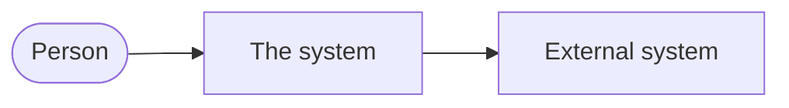
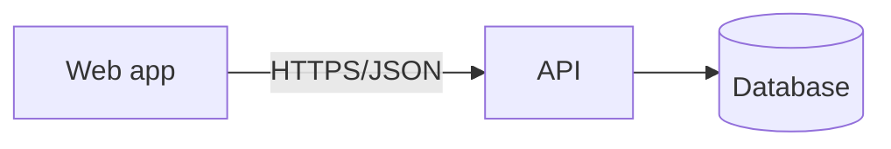

# System Architecture

C4 model of the whole system as approved. One row per element; the code, contracts, and request designs hold the detail.

## Metadata
- Last changed by request:
- G4 decision for that change:
- Date:

## 1. System context (C4 level 1)

| ID | Person or external system | Interaction with the system | Since (request) |
|---|---|---|---|

## 2. Containers (C4 level 2)

| ID | Container | Technology | Responsibility | Data it owns | Talks to (ID, protocol) | Code location | Since (request) |
|---|---|---|---|---|---|---|---|

## 3. Components (C4 level 3)
<!-- Only for containers a request has changed. -->

### <container ID>: <name>
| ID | Component | Responsibility | Code location | Depends on (IDs) | Since (request) |
|---|---|---|---|---|---|

## 4. Trust boundaries
| Boundary | Between (IDs) | What crosses it | Threat model |
|---|---|---|---|

## 5. Change history
| Date | Request | Elements added, changed, or removed (IDs) | G4 decision |
|---|---|---|---|
