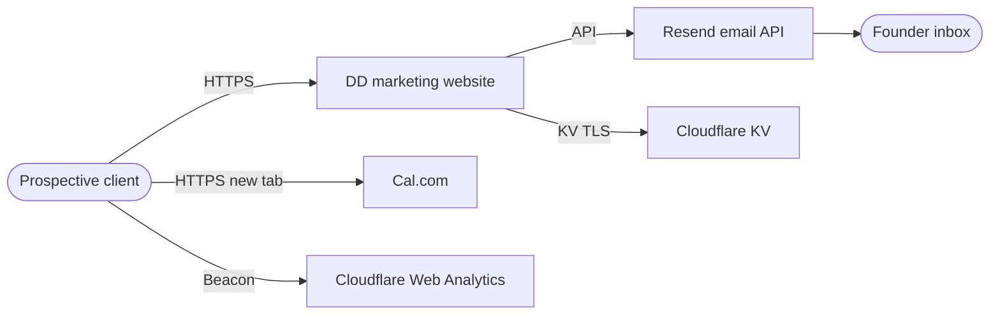
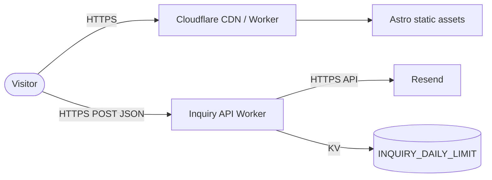

# System Architecture

C4 model of the whole system as approved. One row per element; the code, contracts, and request designs hold the detail.

## Metadata
- Last changed by request: `inquiry-email-daily-limit`
- G4 decision for that change: (pending S3.3)
- Date: 2026-11-26

## 1. System context (C4 level 1)

| ID | Person or external system | Interaction with the system | Since (request) |
|---|---|---|---|
| CTX-VISITOR | Prospective SMB client | Browses single-page site, submits inquiry, opens booking | company-branding-website |
| CTX-FOUNDER | Duong (Young) Dang | Receives inquiry email; holds Cal.com consultations | company-branding-website |
| EXT-RESEND | Resend | Sends inquiry email to designated inbox | company-branding-website |
| EXT-CALCOM | Cal.com | Hosts 30-minute booking flow | company-branding-website |
| EXT-ANALYTICS | Cloudflare Web Analytics | Cookieless page-view beacon | company-branding-website |
| EXT-KV | Cloudflare KV | Ephemeral per-email daily counters (hashed keys) | inquiry-email-daily-limit |
| SYS-WEBSITE | DD Software Solutions marketing website | Public marketing and contact | company-branding-website |

## 2. Containers (C4 level 2)

| ID | Container | Technology | Responsibility | Data it owns | Talks to | Code location | Since |
|---|---|---|---|---|---|---|
| CTR-MARKETING-SITE | Marketing static site | Astro 5, HTML/CSS/TS | Public pages, theme, nav, client form UX | None | CTR-INQUIRY-API (HTTPS) | `web/` | company-branding-website |
| CTR-INQUIRY-API | Inquiry API | Cloudflare Worker (`@astrojs/cloudflare`) | Validate, anti-spam, rate limits, email delivery | Daily count keys in KV (transient) | EXT-RESEND, EXT-KV | `web/src/pages/api/inquiry.ts` | company-branding-website |
| CTR-CDN | Edge CDN + Worker host | Cloudflare | TLS, cache, serverless routes | — | — | `web/wrangler.toml` | company-branding-website |

## 3. Components (C4 level 3)

### CTR-MARKETING-SITE: Marketing static site
| ID | Component | Responsibility | Code location | Depends on | Since |
|---|---|---|---|---|---|
| CMP-LAYOUT | Base layout | Header, footer, meta, analytics slot | `web/src/layouts/*` | CMP-THEME-NAV | company-branding-website |
| CMP-THEME-NAV | Theme + navigation | `data-theme`, anchored nav, mobile menu | `web/src/scripts/theme.ts`, `nav.ts` | — | company-branding-website |
| CMP-INQUIRY-FORM | Inquiry form UI | Client validation, submit states, limit copy | `web/src/components/InquiryForm.astro`, `inquiry-form.ts` | CTR-INQUIRY-API | company-branding-website |
| CMP-BOOKING | Booking link | Cal.com CTA | `web/src/components/BookingPanel.*` | EXT-CALCOM | company-branding-website |
| CMP-PRIVACY | Privacy notice | FR-11 disclosures | `web/src/pages/privacy.astro` | — | inquiry-email-daily-limit |

### CTR-INQUIRY-API: Inquiry API
| ID | Component | Responsibility | Code location | Depends on | Since |
|---|---|---|---|---|---|
| CMP-INQUIRY-HANDLER | submitInquiry | OpenAPI `submitInquiry` orchestration | `web/src/pages/api/inquiry.ts` | CMP-* below, EXT-RESEND | company-branding-website |
| CMP-IP-RATE-LIMIT | IP burst limit | 1 POST / IP / 60s (in-memory) | `web/src/lib/inquiry-rate-limit.ts` | — | company-branding-website; changed inquiry-email-daily-limit |
| CMP-DAILY-LIMIT | Email daily cap | Normalize, hash, KV increment (3/UTC day) | `web/src/lib/inquiry-daily-limit.ts`, `inquiry-email-normalize.ts` | EXT-KV | inquiry-email-daily-limit |
| CMP-SPAM-GUARD | Spam checks | Honeypot, optional Turnstile | `web/src/lib/inquiry-validation.ts`, `inquiry-turnstile.ts` | — | company-branding-website |
| CMP-INQUIRY-EMAIL | Email delivery | Resend HTML email | `web/src/lib/inquiry-email.ts` | EXT-RESEND | company-branding-website |

## 4. Trust boundaries
| Boundary | Between | What crosses it | Threat model |
|---|---|---|---|
| BND-PUBLIC-INTERNET | Visitor ↔ CDN/Worker | HTML, assets, inquiry JSON | `docs/company-branding-website/design/THREAT-MODEL.md`; delta `docs/inquiry-email-daily-limit/design/THREAT-MODEL.md` |
| BND-EMAIL | Worker ↔ Resend | PII fields in email payload | company-branding TM-02 |
| BND-KV | Worker ↔ KV | Hashed keys, integer counts | inquiry-email-daily-limit THREAT-MODEL TB-KV |
| BND-THIRD-PARTY | Visitor ↔ Cal.com / Analytics | Booking PII; anonymous beacon | FR-11 |

## 5. Change history
| Date | Request | Elements (IDs) | G4 decision |
|---|---|---|---|
| 2026-11-25 | company-branding-website | Added CTX-*, EXT-*, SYS-WEBSITE, CTR-*, CMP-* (initial) | Approved D17 |
| 2026-11-26 | inquiry-email-daily-limit | Added EXT-KV, BND-KV, CMP-DAILY-LIMIT; changed CMP-IP-RATE-LIMIT, CMP-INQUIRY-HANDLER, CMP-INQUIRY-FORM, CMP-PRIVACY, CTR-INQUIRY-API data | Pending G4 |