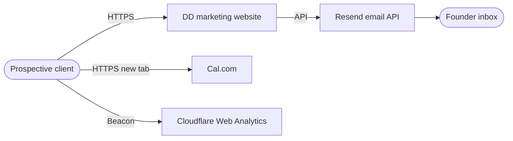
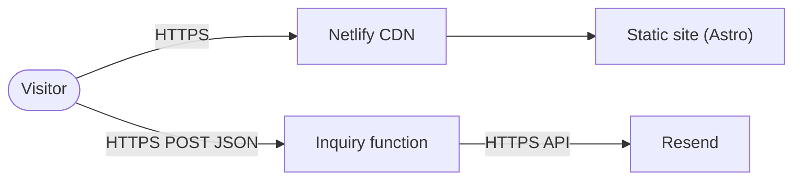

# System Architecture

C4 model of the whole system as approved. One row per element; the code, contracts, and request designs hold the detail.

## Metadata
- Last changed by request: `company-branding-website`
- G4 decision for that change: (pending S3.3)
- Date: 2026-11-25

## 1. System context (C4 level 1)

| ID | Person or external system | Interaction with the system | Since (request) |
|---|---|---|---|
| CTX-VISITOR | Prospective SMB client | Browses single-page site, submits inquiry, opens booking | company-branding-website |
| CTX-FOUNDER | Duong (Young) Dang | Receives inquiry email; holds Cal.com consultations | company-branding-website |
| EXT-RESEND | Resend | Sends inquiry email to designated inbox | company-branding-website |
| EXT-CALCOM | Cal.com | Hosts 30-minute booking flow | company-branding-website |
| EXT-ANALYTICS | Cloudflare Web Analytics | Cookieless page-view beacon | company-branding-website |
| SYS-WEBSITE | DD Software Solutions marketing website | Public marketing and contact | company-branding-website |

## 2. Containers (C4 level 2)

| ID | Container | Technology | Responsibility | Data it owns | Talks to | Code location | Since |
|---|---|---|---|---|---|---|
| CTR-MARKETING-SITE | Marketing static site | Astro 4, HTML/CSS/TS | All public pages, theme, nav, client form UX | None (stateless) | CTR-INQUIRY-API (HTTPS) | `web/` (planned) | company-branding-website |
| CTR-INQUIRY-API | Inquiry API | Netlify Function (Node) | Validate, anti-spam, email delivery | None (transient) | EXT-RESEND (HTTPS) | `web/netlify/functions/inquiry.ts` (planned) | company-branding-website |
| CTR-CDN | Edge CDN | Netlify | TLS, cache static assets | — | — | Netlify project | company-branding-website |

## 3. Components (C4 level 3)

### CTR-MARKETING-SITE: Marketing static site
| ID | Component | Responsibility | Code location | Depends on | Since |
|---|---|---|---|---|---|
| CMP-LAYOUT | Base layout | Header, footer, meta, analytics slot | `web/src/layouts/*` | CMP-THEME-NAV | company-branding-website |
| CMP-THEME-NAV | Theme + navigation | `data-theme`, anchored nav, mobile menu | `web/src/scripts/theme.ts`, `nav.ts` | — | company-branding-website |
| CMP-INQUIRY-FORM | Inquiry form UI | Client validation, submit states | `web/src/components/InquiryForm.*` | CTR-INQUIRY-API | company-branding-website |
| CMP-BOOKING | Booking link | Cal.com CTA | `web/src/components/BookingPanel.*` | EXT-CALCOM | company-branding-website |

### CTR-INQUIRY-API: Inquiry API
| ID | Component | Responsibility | Code location | Depends on | Since |
|---|---|---|---|---|---|
| CMP-INQUIRY-HANDLER | submitInquiry | OpenAPI `submitInquiry` | `web/netlify/functions/inquiry.ts` | EXT-RESEND | company-branding-website |
| CMP-SPAM-GUARD | Spam checks | Honeypot, rate limit, optional Turnstile | same function module | — | company-branding-website |

## 4. Trust boundaries
| Boundary | Between | What crosses it | Threat model |
|---|---|---|---|
| BND-PUBLIC-INTERNET | Visitor ↔ CDN/Function | HTML, assets, inquiry JSON | `design/THREAT-MODEL.md` (pending security-engineer) |
| BND-EMAIL | Function ↔ Resend | PII fields in email payload | Pending |
| BND-THIRD-PARTY | Visitor ↔ Cal.com / Analytics | Booking PII; anonymous beacon | Privacy notice FR-11 |

## 5. Change history
| Date | Request | Elements (IDs) | G4 decision |
|---|---|---|---|
| 2026-11-25 | company-branding-website | Added CTX-*, EXT-*, SYS-WEBSITE, CTR-*, CMP-* | Pending G4 |