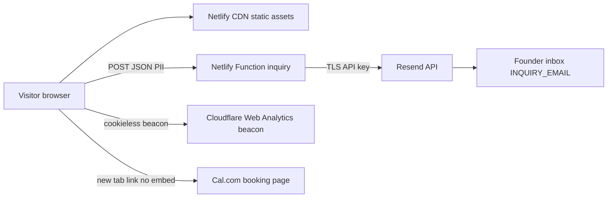

# Threat Model

## Metadata
- Architecture version: `docs/company-branding-website/design/ARCHITECTURE.md` (2026-11-25, S3.1)
- PRD version: `1.0` (`docs/baselines/prds/PRD-v1.0.md`)
- Author: security-engineer (S3.1)
- Date: 2026-11-25

## 1. Data flow and trust boundaries

### Actors, components, data stores, external services

- **In-scope server path:** Visitor submits `name`, `email`, optional `phone`, `message`, honeypot `hp` (and optional Turnstile token when enabled) → `POST /api/inquiry` → validation and spam checks → Resend `POST /emails` → founder inbox. No database; email is the system of record (NFR-05, W2).
- **Out of band:** Cal.com booking is an external URL (`PUBLIC_BOOKING_URL`); no inquiry API processes booking data (ADR-3). Analytics loads a cookieless script; it must not receive form field values.

### Trust boundaries

| ID | Boundary | What crosses it | Trust model |
|---|---|---|---|
| TB-01 | Internet → Netlify CDN | HTML, CSS, JS, images | Public static content; integrity via deploy pipeline and HTTPS |
| TB-02 | Browser → `POST /api/inquiry` | JSON body + client IP (for rate limit) | **Untrusted input**; every field validated server-side |
| TB-03 | Function → Resend | PII in email body, `RESEND_API_KEY` | TLS; API key from Netlify env only; Resend named in privacy notice (FR-11, NFR-06) |
| TB-04 | Function → Netlify logs | Structured events | **No PII** in log payloads (TM-03) |
| TB-05 | Browser → Cal.com | Visitor identity and slot data | Third-party; disclosed in privacy notice; not embedded (FR-14 / R6) |
| TB-06 | Browser → Cloudflare Web Analytics | Page views, coarse metrics | Cookieless; no inquiry content (FR-14) |
| TB-07 | Build/CI → deploy artifact | Env substitution, secrets | Secrets never in `PUBLIC_*` or client bundle (TM-04) |

## 2. Assets and data classification

| Asset or data flow | Classification (public / internal / personal / sensitive / secret) |
|---|---|
| Marketing copy, tokens, CSS, JS on CDN | public |
| `PUBLIC_BOOKING_URL`, `PUBLIC_PUBLIC_EMAIL`, phone, LinkedIn | public (configuration surfaced in UI) |
| `INQUIRY_EMAIL` (delivery destination) | internal |
| Inquiry fields: name, email, phone, message | personal (PII); transient in function memory only |
| Email message in Resend transit and inbox | personal |
| `RESEND_API_KEY`, `TURNSTILE_SECRET_KEY` | secret |
| Turnstile site key (if used) | public (client widget) |
| Netlify function logs (allowed fields: event, request id, outcome) | internal |
| Cal.com session on vendor origin | personal (visitor ↔ Cal.com; not stored by site) |

## 3. Threats

| ID | Boundary | Category | Threat | Likelihood | Impact | Severity |
|---|---|---|---|---|---|---|
| TM-01 | TB-02 | Denial of service / abuse | Automated spam or bulk submissions flood inbox or exhaust Resend/Function quota; bots evade client-only checks | High | Medium | **Important** |
| TM-02 | TB-02, TB-03 | Information disclosure | Inquiry PII intercepted or sent without TLS to Resend | Low | High | **Important** |
| TM-03 | TB-04 | Information disclosure | Full inquiry body, email, or phone written to function or platform logs | Medium | High | **Important** |
| TM-04 | TB-07 | Information disclosure | `RESEND_API_KEY` or `TURNSTILE_SECRET_KEY` committed or bundled into client JS | Low | High | **Important** |
| TM-05 | TB-02, TB-03 | Tampering | HTML/script injection in `name`, `message`, or `phone` renders in founder’s HTML email (XSS in mail client) | Medium | Medium | **Important** |
| TM-06 | TB-02 | Information disclosure | Stack traces or internal errors returned to browser in API responses | Low | Medium | **Important** |
| TM-07 | TB-02 | Tampering | Extra JSON properties or oversized payloads used to confuse parsers or bypass limits | Low | Low | Non-blocking |
| TM-08 | TB-02 | Repudiation | No server-side record of spam rejections beyond metrics | Low | Low | Non-blocking |
| TM-09 | TB-05 | Information disclosure | Cal.com embed would set cookies and expand tracking surface (R6) | N/A (mitigated by ADR-3) | Low | Non-blocking |
| TM-10 | TB-06 | Tampering / disclosure | Analytics script exfiltrates form values | Very low | Medium | Non-blocking |
| TM-11 | TB-02 | Spoofing | Turnstile token replay or missing verification when widget is shown | Medium (if Turnstile on) | Medium | **Important** (when enabled) |

Likelihood and impact are qualitative for a low-traffic marketing site with no authenticated users.

## 4. Mitigations

| Threat ID | Mitigation | Kind | Applies to | How it is tested |
|---|---|---|---|---|
| TM-01 | **Required:** honeypot `hp` must be empty (contract `maxLength: 0`); non-empty → spam path. **Required:** IP rate limit **5 requests per minute** per client IP on `/api/inquiry` → `429` `rate_limited`. Otherwise classified spam → `200` `{ sent: false, rejected: true }` with no Resend call (BR-07). **Optional Turnstile** when `TURNSTILE_SECRET_KEY` is set (see disposition below). | security requirement | `cbw-be-01`, `cbw-fe-02` | Unit tests; contract test; manual burst from preview |
| TM-02 | HTTPS on Netlify; TLS for Resend API client; no plain HTTP for site or handler. | design item | Netlify, `cbw-be-01` | Deploy defaults; smoke |
| TM-03 | Log only: `event`, opaque `requestId`, `outcome` (`sent` / `rejected` / `validation_failed` / `delivery_failed` / `rate_limited`). Never log `name`, `email`, `phone`, `message`, or Turnstile token. | security requirement | `cbw-be-01` | Code review S4.4; ENGINEERING-STANDARDS §4 |
| TM-04 | Secrets only in Netlify env; never `PUBLIC_*`; no Resend import in `web/src/`. | design item | devops, all PRs | gitleaks; ESLint restricted imports |
| TM-05 | HTML-escape all user-supplied fields in Resend email template; `additionalProperties: false` on request schema; Astro auto-escape in UI for any echoed values. | security requirement | `cbw-be-01` | Unit test with `<script>` payload |
| TM-06 | Map errors to OpenAPI bodies only; no stack in JSON. | security requirement | `cbw-be-01` | Contract tests |
| TM-07 | Enforce OpenAPI max lengths and formats; reject unknown properties. | security requirement | `cbw-be-01` | Contract + validation tests |
| TM-11 | When Turnstile enabled, verify token server-side before delivery; invalid/missing token → spam path or safe error without leaking verify detail. | security requirement | `cbw-be-01` (conditional) | Tests with invalid token when keys present |
| TM-09 | Booking: external link `rel="noopener noreferrer"` only (ADR-3). | design item | `cbw-fe-02` | UX/e2e link attributes |
| TM-10 | Cloudflare Web Analytics cookieless beacon only; no custom events with form fields. | security requirement | `cbw-devops-01`, frontend | Review; FR-14 checklist |

### Turnstile disposition (G4 / R3)

| Option | Decision |
|---|---|
| Required at launch | **No** — honeypot + rate limit meet NFR-06 and BR-07 for initial release. |
| Optional (env-gated) | **Yes** — implement verify path in `cbw-be-01`; enable in production by setting `TURNSTILE_SECRET_KEY` and client site key without a new slice. |
| Defer entirely | **No** — wire optional verification now to avoid a follow-up contract change if spam volume rises. |

**Human acceptance:** Owner may enable Turnstile after launch if inbox spam remains high; privacy notice must mention Cloudflare Turnstile when enabled (FR-11).

### Security gates (ENGINEERING-STANDARDS)

| Threat | Tool gate | Notes |
|---|---|---|
| TM-04 secrets in repo | gitleaks | Confirmed adequate |
| TM-05, TM-06 injection / unsafe patterns | eslint-plugin-security on `web/netlify/functions/` and `web/src/scripts/` | Confirmed adequate |
| Dependency risk | `npm audit` no new high/critical | Confirmed adequate |
| TM-03 PII in logs | review + S4.4 security review | Not automatable; requirement in §4 |

No new CI gate required for rate limit logic; **contract and unit tests** are the enforcement (per IMPLEMENTATION-PLAN).

## 5. Accepted risks

| Threat ID | Why accepted | Owner who must accept |
|---|---|---|
| TM-08 | Spam rejections are counted in metrics only; email is sole audit for delivered inquiries | Founder (Duong) |
| TM-10 | Residual browser/ad-block risk for analytics; does not affect inquiry confidentiality | Founder |
| TM-01 (residual) | Determined bots may occasionally reach inbox despite honeypot + rate limit; Turnstile optional escalation | Founder; enable Turnstile if spam unacceptable |

## 6. Slice impact and merge posture

| Slice part | Blocking security findings for start of implementation | Blocking for merge (S4.4) |
|---|---|---|
| **cbw-be-01** | None after this document is published | Fail S4.4 if honeypot, rate limit (5/min/IP), PII-safe logging, HTML escape, or OpenAPI error shapes missing |
| cbw-fe-02 | None | Hidden honeypot; client honors `rejected` (no success UI); optional Turnstile widget when keys configured |
| cbw-devops-01 | None | Secrets in Netlify only; HTTPS |

**cbw-be-01 design-time block:** **None** — developers may implement per this model.

IDs TM-01–TM-05 align with `design/ARCHITECTURE.md` §8 security design items.