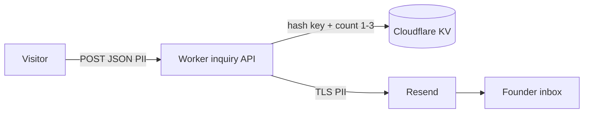

# Threat Model

## Metadata
- Architecture version: `docs/inquiry-email-daily-limit/design/ARCHITECTURE.md` (2026-11-26)
- PRD version: `1.1` (`docs/baselines/prds/PRD-v1.1.md`)
- Author: architect (S3.1 draft — **pending security-engineer S4.4 review** on Sensitive PR)
- Date: 2026-11-26
- Baseline threat model: `docs/company-branding-website/design/THREAT-MODEL.md` (extend, do not replace)

## 1. Data flow and trust boundaries (delta)

| ID | Boundary | What crosses it | Trust model |
|---|---|---|---|
| TB-KV | Worker ↔ Cloudflare KV | SHA-256 key (peppered normalized email + UTC day); value = integer count | **Internal store**; no plaintext email; counts only |
| TB-02 | (unchanged) | Visitor JSON to Worker | Untrusted input |

## 2. Assets and data classification (delta)
| Asset or data flow | Classification |
|---|---|
| KV record (hashed key + count) | internal (derived personal data — rate-limit artifact) |
| `INQUIRY_LIMIT_HASH_PEPPER` | secret |
| Normalized email in Worker memory (transient) | personal |

## 3. Threats (new or changed)
| ID | Boundary | Category | Threat | Likelihood | Impact | Severity |
|---|---|---|---|---|---|---|
| TM-01 | TB-02, TB-KV | DoS / abuse | Repeat inquiries with same email exhaust inbox; IP-only limit insufficient | High | Medium | **Important** (mitigated by FR-15) |
| TM-15 | TB-KV | Disclosure | KV dump or dashboard leak reveals hashes linkable to email if pepper weak/missing | Low | Medium | **Important** |
| TM-16 | TB-KV | Elevation | Over-privileged API token mutates unrelated KV | Low | Medium | Important |
| TM-01 (residual) | TB-KV | DoS | KV race allows 4th delivery same day | Low | Low | Non-blocking |
| TM-12 | TB-02 | DoS | IP limit per isolate only; burst across isolates | Low | Low | Non-blocking (ADR-7) |

## 4. Mitigations (delta)
| Threat ID | Mitigation | Kind | Applies to | Tested by |
|---|---|---|---|---|
| TM-01 | Per-email cap 3/UTC day after normalization; IP 1/min first (BR-13) | security requirement | `iedl-be-01` | Contract + unit; cross-isolate test with mocked KV |
| TM-15 | Pepper in Worker secret; SHA-256; never store raw email in KV; privacy notice (FR-11) | security requirement | `iedl-be-01`, `iedl-fe-01` | Code review S4.4; no email in KV integration test |
| TM-16 | Dedicated KV namespace; deploy token scoped to Worker + this namespace | design item | `iedl-devops-01` | Setup guide checklist |
| TM-03 | No hash/key/email in logs for daily limit events | security requirement | `iedl-be-01` | ENGINEERING-STANDARDS §4 |

### TM-01 change from baseline
| Control | Baseline | This request |
|---|---|---|
| IP POST limit | 5 / 60s | **1 / 60s** (BR-13) |
| Per-email limit | None | **3 / UTC calendar day** (KV) |

## 5. Accepted risks (delta)
| Threat ID | Why accepted | Owner |
|---|---|---|
| TM-01 (KV race) | Low traffic; cap still blocks scripted bulk; DO rejected for simplicity | Founder G4 |
| TM-12 (IP isolate) | BR-13 does not require global IP accuracy | Founder G4 |